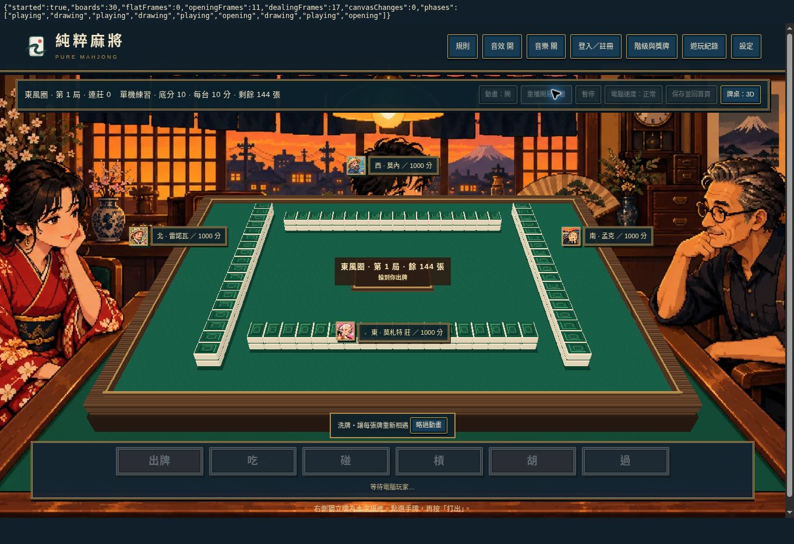

# V1.5.1 全程統一立體牌桌

## 修正原因

V1.5 的渲染配接層遇到 `.is-opening` 或 `.is-dealing` 時，會主動 dispose 3D 場景、回到原 CSS 牌桌。因此玩家出牌後，只要電腦摸牌、補花或重新發牌，畫面就會短暫變平。

## 修正

移除上述動畫階段排除條件，讓同一個場景及畫布讀取各個公開動畫 snapshot。單機與好友房 DOM 完成後同步掛載呈現層，避免等到下一個 MutationObserver frame 才套用立體介面。相同尺寸更新不重設 canvas，保留前一個立體畫面直到下一次繪製。

原本的動畫計時器、操作鎖定、略過動畫、進度及補花提示保留；原平面飛牌與洗牌插畫由同一 3D 桌面的牌牆、手牌變化呈現。狀態提示改成桌緣小面板。引擎、AI、計分、API、保存與恢復方式均未更動。使用者主動選擇相容模式仍可使用原介面；正常動畫不會自動切回平面。

## 驗證

- `node tests/table-continuity.cjs`：同一 scene 穿越 playing → dealing → opening → dealing → playing；動畫階段首次進入也可建立 3D；單機與好友房均有同步掛載 hook；使用者明確選擇相容模式仍可切換。
- `node tests/core.cjs`：100 局完整對局、分數守恆、受保護引擎及儲存程式碼一致、20 階級及144張牌面標籤通過。
- 實際瀏覽器連續性監測：選三萬出牌、電腦摸打、輪回玩家、重播開局及發牌。第一輪共記錄 29 次牌桌 DOM，包含開局與摸牌動畫；平面 frame=0、canvas 更換=0。不是只檢查靜止畫面。
- `tests/continuous-table.html` 提供逐幀監測，可在頁面上看到計數。測試環境 WebGL 被停用，使用相同模型的 software-3d 後端；GPU 光影與實機效能尚待驗收。

正式網站仍未覆蓋；這次修正更新同一預覽分支與草稿 PR。

